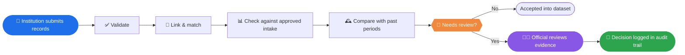
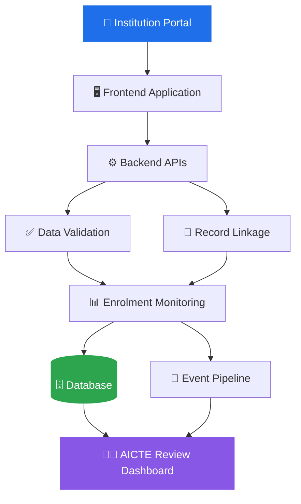

<div align="center">

# 🎓 APAAR Connect

### *Intelligent Student Data Verification & Monitoring Platform.*

**An explainable student-data verification and monitoring platform for AICTE-approved institutions.**

<br/>


<br/>

[Overview](#-overview) •
[Problem](#-the-problem) •
[Solution](#-our-solution) •
[Difference](#-what-makes-apaar-connect-different) •
[Tech Stack](#-proposed-technology-stack) •
[Security](#-security-and-privacy) •
[Impact](#-expected-impact) •
[References](#-references) •
[Team](#-team)

</div>

---

## 🔭 Overview

**APAAR Connect** is a proposed platform that helps authorized officials trust the student data they review.

Institutions submit records in a standard format. The platform validates them, links potential duplicates, compares reported enrolment against approved intake, tracks quality across reporting periods, and shows everything in one review dashboard. Each alert explains **why** it was raised and **what evidence** supports it.

Built for **Smart India Hackathon (SIH) 2026 — Problem Statement SIH26263**.

> [!IMPORTANT]
> **Design principle:** A flagged record is a *request for review*, not proof of fraud or a regulatory violation.



---

## 🚨 The Problem

Student data arrives from many institutions, in many shapes, and officials have to make decisions on top of it.

| | Challenge | What it looks like |
|:-:|---|---|
| 🧩 | **Fragmented records** | Different formats and different levels of detail for the same kind of information |
| 👥 | **Duplicate entries** | Repeated or conflicting records that quietly weaken data quality |
| ⚠️ | **Inconsistent information** | Missing fields and conflicting values that make verification slow |
| 📉 | **Enrolment discrepancies** | Reported counts that differ from approved intake and applicable provisions |
| 🙈 | **Limited visibility** | No consolidated view of submissions, quality, and unresolved issues |

**APAAR Connect replaces scattered checking with one standardized, evidence-driven workflow.**

---

## 💡 Our Solution

Five capabilities, one pipeline.

<table>
<tr>
<td width="50%" valign="top">

### 🗂️ 1. Centralized Data Management
- Standardized student-record submission
- Institution-wise organization
- APAAR-linked records, subject to authorization and access

</td>
<td width="50%" valign="top">

### 🛡️ 2. Automated Record Validation
- Required-field and format checks
- Potential duplicate detection
- Missing and inconsistent information surfaced
- Plain-language reason for every flag

</td>
</tr>
<tr>
<td width="50%" valign="top">

### 🎯 3. Intake-Aware Monitoring
- Reported enrolment vs. approved intake
- Configurable checks for applicable provisions
- Alerts for discrepancies that need investigation

</td>
<td width="50%" valign="top">

### 🕰️ 4. Historical Quality Monitoring
- Submissions compared across reporting periods
- Unusual enrolment variations highlighted
- Recurring errors and open discrepancies tracked

</td>
</tr>
<tr>
<td colspan="2" valign="top">

### 📊 5. Analytics & Review Dashboard
Institution-wise summaries • validation results • duplicate alerts • enrolment trends • data-quality indicators • review status • audit history for authorized officials

</td>
</tr>
</table>

### 🏗️ Proposed Architecture



> [!NOTE]
> This is the intended architectural direction. Components and integrations will be verified as implementation progresses. Authoritative APAAR verification would need an approved integration, and identifier-format checks are never treated as official identity verification.

---

## ✨ What Makes APAAR Connect Different?

Most tools store records and draw charts. APAAR Connect is built around **reviewability**.

| 💎 Capability | 🎁 Value to the reviewer |
|---|---|
| 🔍 **Explainable alerts** | See exactly why a record needs attention |
| 🔗 **Cross-record consistency** | Spot potential conflicts across submissions |
| 🎯 **Intake-aware validation** | Judge discrepancies against configured rules |
| 🕰️ **Historical monitoring** | Watch how an institution's data changes over time |
| 🧾 **Evidence-linked review** | Investigate and document decisions in one place |
| 🔐 **Privacy-aware access** | Student data limited to authorized purposes and users |

### What an explainable alert is meant to look like

*(Illustrative mock-up with fictional values. Not real data.)*

```text
┌──────────────────────────────────────────────────────────────┐
│ 🚩 REVIEW REQUESTED                          Priority: Medium │
├──────────────────────────────────────────────────────────────┤
│ Why flagged                                                  │
│   • Reported enrolment exceeds configured approved intake    │
│   • 2 records share matching name + date of birth            │
│                                                              │
│ Evidence                                                     │
│   • Submission: <period>   • Rule: <configured rule id>      │
│   • Potential duplicate pair: <record A> ↔ <record B>        │
│                                                              │
│ Status: Open     Assigned to: <official>                     │
│ Note: This is a request for review, not a finding.           │
└──────────────────────────────────────────────────────────────┘
```

---

## 🛠️ Proposed Technology Stack

| Layer | Technology |
|---|---|
| 🎨 **Frontend** |    |
| ⚙️ **Backend APIs** |   |
| 🗄️ **Database** |  |
| 🧮 **Data processing** |  |
| 🔗 **Record matching** | Exact matching + suitable fuzzy-matching techniques |
| 🧠 **Anomaly detection** |  where justified by available data |
| 📨 **Event streaming** |  if required by the implemented architecture |
| 📦 **Deployment** |  |
| 📈 **Visualization** | Plotly or an equivalent dashboard library |
| 🔐 **Security** | Role-based access, secure transport, audit logging |

> [!NOTE]
> The final stack will reflect the technologies actually implemented in this repository.

---

## 🔐 Security and Privacy

Student information is sensitive, so privacy is part of the design from the start.

| 🛡️ Principle | In practice |
|---|---|
| **Least privilege** | Role-based authorization for institutions and officials |
| **Data minimization** | Collect only the student information that is necessary |
| **Careful handling** | Secure treatment of identifiers and sensitive records |
| **Accountability** | Auditable access and review actions |
| **Protected secrets** | Configuration and environment secrets kept out of the codebase |
| **Safe development** | Synthetic or appropriately anonymized data for development and demos |

> [!WARNING]
> Production deployment would require additional security testing, operational controls, and approval for any official data integration.

---

## 🎯 Expected Impact

| 📈 Outcome | Who benefits |
|---|---|
| Greater **student-record consistency** across participating institutions | Institutions, AICTE |
| **Early identification** of potential data-quality issues | Institutions, reviewers |
| More **efficient review** of flagged records | Authorized officials |
| Clearer **visibility** into enrolment patterns and unresolved discrepancies | Decision-makers |
| Stronger **accountability** through evidence-based review histories | The whole ecosystem |

> [!NOTE]
> These are intended outcomes. They will be validated through testing on synthetic datasets and through stakeholder feedback.

---

## 📚 References

- 🏆 [Smart India Hackathon](https://www.sih.gov.in/)
- 🪪 [Official APAAR Portal](https://apaar.education.gov.in/)
- 🏛️ [National Academic Depository](https://nad.digilocker.gov.in/)

---

## 👥 Team

<div align="center">

| | |
|---|---|
| **Project** | APAAR Connect |
| **Competition** | Smart India Hackathon 2026 |
| **Problem Statement ID** | SIH26263 |
| **Domain** | Smart Automation |
| **Team name** | 555_ATHENA |

</div>

<div align="center">

**🎓 APAAR Connect: building a more consistent, accountable, and data-driven academic ecosystem.**

</div>
