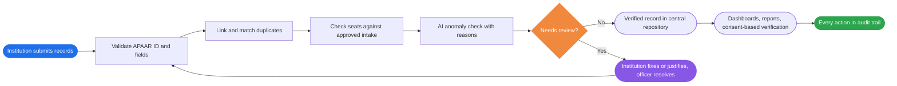
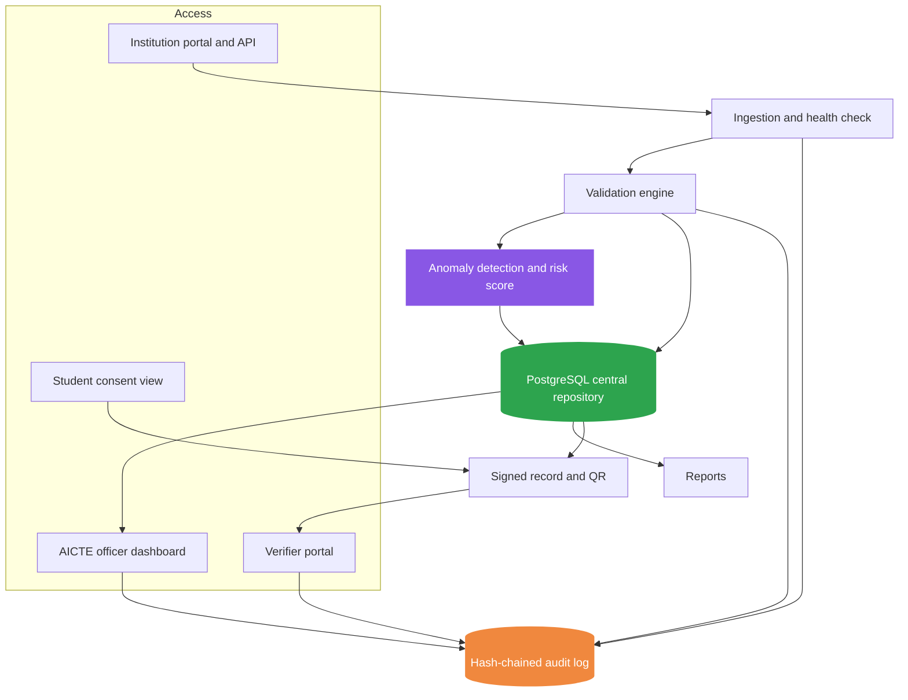

<div align="center">

# 🎓 APAAR Connect

### *Verified student records. Explainable alerts. Audit-ready governance.*

**An APAAR ID-based student data verification and monitoring platform for AICTE-approved institutions.**

<br/>


<br/>

[Why now](#-why-now) •
[Problem](#-the-problem) •
[Solution](#-our-solution) •
[Prototype](#-the-prototype) •
[What's different](#-what-makes-apaar-connect-different) •
[Seat rules](#-category-aware-seat-rules) •
[Architecture](#-architecture) •
[Tech stack](#-technology-stack) •
[Security](#-security-and-privacy) •
[Status](#-project-status) •
[Team](#-team)

</div>

---

## 🔭 Overview

**APAAR Connect** helps AICTE and approved institutions trust student data.

Institutions submit student-level records keyed on each student's **APAAR ID**. The platform validates them, links potential duplicates (including across institutions), checks enrolment against approved intake by seat category, and shows everything on a review dashboard. Every alert says **why** it was raised and **what evidence** supports it. Verified records can be checked by authorised parties with student consent, and every action is written to a tamper-evident audit trail.

Built for **Smart India Hackathon 2026, Problem Statement SIH26263**: *Development of an APAAR ID-Based Student Data Management and Verification Platform for AICTE-Approved Institutions.*

> [!IMPORTANT]
> **Design principle:** a flagged record is a *request for review*, not proof of fraud or a regulatory violation.



---

## 📌 Why now

- <b>26.35 crore</b> verified APAAR IDs existed as of July 2026 ([PIB figure, via Education Post](https://educationpost.in/news/explained/explained-apaar-id-one-nation-one-student-id)), so the national identifier is ready.
- AICTE's 2026-27 approval process now requires approved institutions to **submit all details of their students** to the council ([Careers360](https://news.careers360.com/aicte-approval-process-handbook-2026-27-update-engineering-college-business-school-management-foreign-student-seats-minor-diploma)).
- Yet most institutions beyond PGDM have historically reported **only enrolment totals**, which makes duplicates, excess intake and fake records hard to catch.

---

## 🚨 The Problem

| | Challenge | What it looks like |
|:-:|---|---|
| 🧩 | **Fragmented records** | Different formats and levels of detail across institutions |
| 👥 | **Duplicate entries** | Repeated records, and the same student enrolled in two institutions |
| ⚠️ | **Inconsistent information** | Missing or invalid APAAR IDs, conflicting fields |
| 📉 | **Enrolment vs intake** | Reported counts exceeding approved intake, with no seat-category view |
| 🙈 | **Limited visibility** | No consolidated, real-time view of submissions and unresolved issues |

---

## 💡 Our Solution

<table>
<tr>
<td width="50%" valign="top">

### 🗂️ 1. Secure submission
- Portal, bulk CSV or API upload, plus manual entry for single admissions
- Records keyed on APAAR ID
- Final declaration locks the data; later changes need an amendment

</td>
<td width="50%" valign="top">

### 🛡️ 2. Automated validation
- Missing or invalid APAAR IDs
- Duplicate records, within and across institutions
- Cross-field consistency checks
- Plain-language reason for every flag

</td>
</tr>
<tr>
<td width="50%" valign="top">

### 🎯 3. Seat-category-aware intake checks
- Regular, supernumerary, NRI, OCI and foreign national seats tracked separately
- Reported enrolment compared with approved intake per course
- Provisional ID flow for students without an APAAR ID

</td>
<td width="50%" valign="top">

### 🧠 4. Explainable anomaly detection
- Flags unusual enrolment against history
- Institution risk score to prioritise reviews
- Each alert shows evidence and feature contributions

</td>
</tr>
<tr>
<td width="50%" valign="top">

### 📊 5. Real-time dashboards and reports
- Institution view and AICTE state-level view
- Exportable reports for policy, accreditation and audits

</td>
<td width="50%" valign="top">

### 🔐 6. Consent-based verification and audit
- Employers and regulators get a minimal "verified" result and a signed QR
- Hash-chained audit trail for every enrolment, review and verification

</td>
</tr>
</table>

---

## 🖥️ The Prototype

A clickable **UI prototype** with five role views is included in [`frontend/prototype`](frontend/prototype). It uses **sample data only**.


| Role | What it shows |
|---|---|
| 🏫 **Institution admin** | Enrolment vs intake, verified IDs, flagged records, batch upload, manual entry, student ledger, dual-enrolment alert and student dossier with explanation |
| 🧑‍⚖️ **AICTE officer** | State-wise compliance matrix, ranked anomaly queue, live intake feed |
| 🛠️ **Super admin** | System health and institute registry with access controls |
| 🏢 **Verifier / employer** | Single and bulk APAAR verification with a signed QR result |
| 📜 **Auditor** | Hash-chained audit ledger with an integrity check |

**Run it:** open [`frontend/prototype/code.html`](frontend/prototype/code.html) in a browser (internet needed for the Tailwind CDN).

> [!NOTE]
> All names, institutions and figures on the prototype screens are illustrative sample values, not real data. The backend services described below are planned, not yet implemented.

---

## ✨ What makes APAAR Connect different?

Most tools store records and draw charts. APAAR Connect is built around **reviewability**.

| 💎 Capability | 🎁 Value |
|---|---|
| 🔍 **Explainable alerts** | Reviewers see exactly why a record was flagged |
| 🎯 **Category-aware intake engine** | Supernumerary, NRI, OCI and FN seats checked on their own rules |
| 🔗 **Cross-institution duplicate check** | Same APAAR ID in two institutions is surfaced early |
| 🔄 **Flag-and-respond workflow** | Flag, institution response, officer resolution, all logged |
| 🧾 **Verifiable records** | Signed QR and minimal-disclosure checks, with student consent |
| 🧱 **Tamper-evident audit trail** | History cannot be silently edited |

### What an explainable alert looks like

*(Illustrative mock-up with fictional values.)*

```text
┌──────────────────────────────────────────────────────────────┐
│ 🚩 REVIEW REQUESTED                          Priority: Medium │
├──────────────────────────────────────────────────────────────┤
│ Why flagged                                                  │
│   • Same APAAR ID found in two institutions                  │
│   • NRI seat count above the configured cap for this course  │
│                                                              │
│ Evidence                                                     │
│   • Submission: <period>   • Rule: <configured rule id>      │
│   • Potential duplicate pair: <record A> ↔ <record B>        │
│                                                              │
│ Status: Open     Assigned to: <officer>                      │
│ Note: This is a request for review, not a finding.           │
└──────────────────────────────────────────────────────────────┘
```

---

## 🪑 Category-aware seat rules

Seat categories are handled as **configurable parameters**, so policy changes need no code changes. Final limits should be mapped to the current AICTE Approval Process Handbook.

| Seat type | How it is treated | Example flag |
|---|---|---|
| **Regular (approved intake)** | Enrolment checked against approved intake per course | Intake exceeded |
| **Supernumerary** | Tracked outside approved intake, against its own configured cap | Cap exceeded, or no valid basis |
| **NRI** | Own counter and cap, supporting document reference required | NRI cap exceeded, document missing |
| **OCI** | Own counter, status tied to a document number | OCI without document |
| **Foreign national** | Own counter, passport and visa references, provisional ID if no APAAR ID | FN documents missing |

**Cross-category rules:** a student belongs to one seat category, and category totals must reconcile with declared actual enrolment.

---

## 🏗️ Architecture



> [!NOTE]
> Authoritative APAAR verification needs an approved integration with the official systems. The prototype design uses a mock verification service behind the same interface, so it can be swapped later. Identifier-format checks are never treated as official identity verification.

---

## 🛠️ Technology stack

| Layer | Technology |
|---|---|
| 🎨 **Frontend** |    |
| ⚙️ **Backend APIs** |   |
| 🗄️ **Database** |  |
| 🧮 **Data processing** |  |
| 🔗 **Record matching** | Exact matching plus fuzzy matching |
| 🧠 **Anomaly detection** |  Isolation Forest and trend features, with reason codes |
| 📨 **Event streaming** |  for scalable bulk ingestion (planned) |
| 📦 **Deployment** |  |
| 🔐 **Security** | Role-based access, encryption, audit logging |

---

## 🔐 Security and privacy

| 🛡️ Principle | In practice |
|---|---|
| **Least privilege** | Role-based access for institutions, officers, verifiers and auditors |
| **Consent and minimal disclosure** | Verifiers see only what is needed, with student consent |
| **Data minimisation** | Only necessary student fields are collected |
| **Protected identifiers** | APAAR IDs encrypted or hashed at rest |
| **Accountability** | Hash-chained audit log of uploads, reviews and verifications |
| **Safe development** | Synthetic data only for development and demos |

Designed around the principles of India's Digital Personal Data Protection Act, 2023 (consent, purpose limitation, minimal disclosure).

> [!WARNING]
> Production use would require security testing, operational controls and approval for any official data integration.


---

## 🎯 Expected impact

| 📈 Outcome | Who benefits |
|---|---|
| Authentic, verifiable student records tied to APAAR ID | AICTE, institutions, employers |
| Early detection of duplicates and excess enrolment | AICTE officers |
| Faster, evidence-based review of flagged records | Authorised officials |
| Student control over who can verify their record | Students |
| Accountability through a tamper-evident review history | The whole ecosystem |

> [!NOTE]
> These are intended outcomes, to be validated through testing on synthetic datasets and stakeholder feedback.

---

## 📚 References

- 🏆 [Smart India Hackathon](https://www.sih.gov.in/)
- 🪪 [Official APAAR Portal](https://apaar.education.gov.in/)
- 🏛️ [National Academic Depository](https://nad.digilocker.gov.in/)
- 📰 [APAAR adoption figures (Education Post)](https://educationpost.in/news/explained/explained-apaar-id-one-nation-one-student-id)
- 📰 [AICTE Approval Process 2026-27 update (Careers360)](https://news.careers360.com/aicte-approval-process-handbook-2026-27-update-engineering-college-business-school-management-foreign-student-seats-minor-diploma)

---

## 👥 Team 

<div align="center">

| | |
|---|---|
| **Project** | APAAR Connect |
| **Competition** | Smart India Hackathon 2026 |
| **Problem Statement** | SIH26263 |
| **Team name** | 555_ATHENA |
| **Domain** | Smart Automation |

**🎓 APAAR Connect: authentic records, explainable alerts, accountable governance.**

</div>
